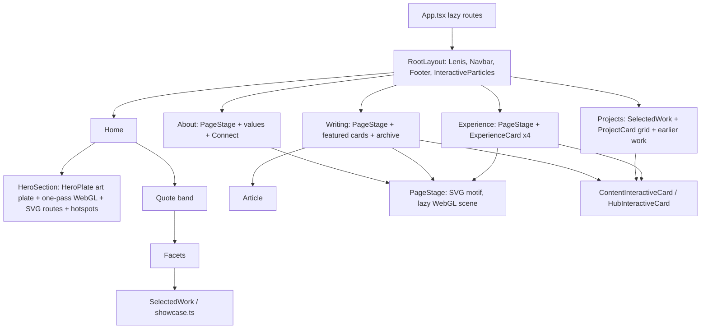

# Portfolio cinematic revamp ledger

Branch `feat/portfolio-cinematic-revamp`, worktree `../amsborse-cinematic-revamp`, based on `master`
at `59cb64f` (2026-11-09). Nothing here is pushed, merged or deployed.

## Skills log

"Skill" means invoked with the Skill tool; "Read" means the full SKILL.md was read from disk.

| Phase | Skill | Load | Steps followed | Skipped, and why |
| --- | --- | --- | --- | --- |
| Before | working-agreements | Skill, loaded | Read `~/agent-skills/working-agreements/AGENTS.md` and `ui-quality.md`; applied release, honesty, scope and UI-taste rules throughout | None |
| Before | sutra-design | Read from the Sutra repo (`.agents/skills/sutra-design/SKILL.md`), read-only | Used its design-quality bar as a reference | Sutra tokens, components and scripts: they belong to Sutra, not this site |
| Before | sutra-ui-taste | Read from the Sutra repo (`.agents/skills/sutra-ui-taste/SKILL.md`), read-only | Applied the taste rules (one signature visual, layered dark, designed light, calm motion) | `references/taste-evidence.md` not read: evidence table only, not rules |
| Before | repo `AGENTS.md` | Read | Followed the task lifecycle (`agent:task` → `review:run` → `agent:finish`), token rules, layout rules | `review:thorough` / `review:cross-browser`: only on explicit request |
| Before | `~/agent-skills/shared/agent-routing.md` | Read | Codex first for UI, images and review; fallback only on `quotaExhausted` | None |
| 1 Audit | local-test-data | Not in the Skill registry. Read from the Sutra repo (`.claude/skills/local-test-data/SKILL.md`), read-only | Applied its principle: fastest local loop, no paid calls. Here that is `npm run build` + `vite preview` with logs in the scratchpad | Postgres/API seeding steps: Sutra-specific, the portfolio has no backend |
| 1 Audit | revamp-ui (audit mode) | Skill, loaded | Real screenshots in both themes, findings ranked by visual impact, unslop `signs.md` checklist | Codex second-opinion review: kept for Phase 7 |
| 1 Audit | understand-code | Skill, loaded | Whole-repo map: shape, entry points, core flow, state, conventions, risks, Mermaid diagram | Parallel explorers: the repo is small enough to read directly |
| 2 Design system | revamp-ui (full revamp) | Skill, loaded; read `workflows/unslop/unslop.md`, `workflows/codex-visual.md`, `references/visuals.md` | Capture, direction, tokens first, passes in order, generated plates, verify with screenshots | "Ask once with numbered options": the brief says not to stop for questions; direction chosen and recorded below |
| 3 UX and motion | build-animation | Skill, loaded; read `workflows/cinematic-plate/cinematic-plate.md` in full | Text-free generated plate per chapter, exported with `export-plate.py`, thin live layers (glow, mist, pointer lean), paused offscreen, reduced-motion path | Shader water on inner plates: two CSS layers are enough there and cost nothing |
| All | coordinate-agents | Skill, loaded; read `workflows/codex-implement.md` and `shared/codex-bridge.md` | Recorded under "Delegation log" | — |

| 4–6 Pages | fix-bug | Skill, loaded | Reproduce, failing regression test, smallest fix, confirm in the built site; entries under "Bug fixes" | None |
| 7 Quality | test-everything | Skill, loaded | Baseline and after counts from real runs, e2e at 360/412/768/1440, flaky runs reproduced and fixed at the cause | Coverage push beyond the branch: out of scope |
| 7 Quality | verify | Skill, loaded | Rebuilt `dist`, after-screenshots of the real preview, Lighthouse on the built site | Both themes for every probe: themes covered in the screenshot set, not in Lighthouse |
| 7 Quality | review-code | Skill, loaded; read `shared/codex-bridge.md` | Codex review of the branch against `master`, every finding verified (below) | Fallback agents: Codex was not out of quota |
| — | local-report, sutra-deploy-rerun | Not used, per the brief | — | Excluded by the brief |

## Phase 1: audit

Scope: the routes listed below, read in code and captured from the production build
(`vite preview`). This is not a claim that every state of every page was reviewed.

### Baseline evidence

- Screenshots: `docs/revamp/baseline/` (`<page>-<width>-<theme>-top.jpg` and `-full.jpg`; widths
  1440, 1920, 768, 390; dark and light), plus `state-*` (mobile menu, scrolled home, card hover,
  reduced motion) and `frames-hero-*` (six frames 700 ms apart and one after a pointer move).
  `manifest.json` in that folder lists every shot, failure and console error.
- Screenshots and raw Lighthouse reports are kept in the worktree but not committed (about
  45 MB, see `.gitignore`); manifests and Lighthouse summaries are committed.
- Tool: `node scripts/revamp-shots.mjs <label>` (new, reused for the after set).
- Checks on `59cb64f`: typecheck pass, lint pass, unit 136/136 pass, production build pass.

### Site map and journeys

| Route | Page | In top nav |
| --- | --- | --- |
| `/` | Hero, quote, facets, selected work | Home |
| `/experience` | Four roles as cards | Experience |
| `/projects` | Selected work, filterable card grid, earlier work list | Projects |
| `/arsenal/writing`, `/arsenal/writing/:slug` | Essay index and five articles | No (footer and a facet only) |
| `/learning` | Learning hub | Learning |
| `/about`, `/about#contact` | Bio, values, contact | About, "Get in touch" |
| `/resume` | Interactive résumé and PDF | Hero link only |
| `/arsenal/*` | Visual labs (WebGL sandboxes) | No |

Journeys today: a recruiter lands on the hero, reads the statement and three proof numbers, and
has "View work", "Experience" and "Resume" within reach: this works. A reader looking for essays
has no nav entry and must find a facet or the footer. Contact is a section at the bottom of About.

### Component map

State: theme in `localStorage["portfolio-theme"]` and `data-theme` on `<html>`; content is static
TypeScript and Markdown; no backend. `three` loads only on the opt-in 3D hero and the labs.

### What is strong (preserve)

1. The hero plate: a mossy island with a bonsai, waterfalls and glass orbital rings around a
   service sphere, on reflective water. It is already nature plus cosmos, it carries real meaning
   (the labelled services are the systems the owner builds) and it is art-directed in both themes.
2. The hero's engineering: one WebGL pass, QA parameters, static fallback, reduced-motion path.
3. Editorial serif headings, the amber accent on black, the warm paper light theme.
4. Selected work on the home page: large real product screenshots, alternating layout.
5. The essay archive list and the article reading column.

### What is weak (ranked by visual impact)

1. **Two visual languages.** The hero is amber, moss and glass. Every inner page switches to teal
   line art in a dark box, multicoloured confetti particles and indigo-to-purple card borders.
   Nothing from the hero's world continues past the first viewport.
2. **Inner-page stages are boxes.** `PageStage` is a dark rounded rectangle in both themes; on the
   light theme it reads as a pasted-in dark card, on phones the motif is cropped to faint rings.
3. **Experience is a résumé dump**, four identical cards with a purple top border and up to ten
   bullets. No timeline, no sense of the systems, no hierarchy between Microsoft/Amazon and the
   internship.
4. **Projects page** repeats the home showcase, then falls into a grid of small identical cards
   with rainbow category borders and tiny text (11 to 12 px), then a third list.
5. **Writing** is not in the navigation; featured cards use an emoji icon, a "FEATURED" pill and
   purple borders, and duplicate the archive directly below.
6. **Global particle network** (pink, green, blue, orange dots and wireframes) sits behind body
   text on every page, competes with content and belongs to no part of the hero's world.
7. **Home below the hero**: the plate ends in a hard horizontal edge on the light theme; the quote
   band and facet grid are plain text on a flat background.
8. **Contact** is a list of uppercase mono labels at the bottom of About.
9. **Article page**: the "All writing" back link sits under the fixed header at 1440 (bug).
10. Tells from the unslop list: indigo/purple gradients, emoji icons, uppercase wide-tracked
    labels, `transition-all`, equal cards in a grid, decorative particles.

### Where the 2.5D illusion breaks

- The plate is a single image: pointer movement shifts it as one sheet, so there is no parallax
  between island, rings and water.
- Water motion is confined to the plate; the reflection stops at the plate's lower edge instead of
  running into the page.
- Inner-page motifs are flat line drawings with no depth layers at all.

### Preservation decisions

- Keep: hero plate and its renderer, hero copy and proof points, service hotspots and console,
  theme system and token names, serif/sans pairing, SelectedWork content, article reader, all
  routes and URLs, résumé page, labs under `/arsenal`.
- Keep as-is, out of scope: the WebGL labs' internals and the résumé PDF pipeline.
- Change: everything listed under "weak". The current inner-page `PageStage` line-art motifs are
  replaced by generated plates in the hero's world; no owner statement in the repo marks them as
  liked (`.agent-memory` holds only "avoid washed-out pale surfaces" and a badge-overlap note).
- Content: only what is in `src/data` and `src/content`. No Topmate link exists in the repo, so
  none is added.

### Performance baseline (measured on `59cb64f`, production build, `npx lighthouse`)

Raw reports: `docs/revamp/lighthouse/baseline/`. Bundle JS total 2030.1 KiB (budget 2200).

| Page | Preset | Perf | A11y | LCP ms | CLS | TBT ms |
| --- | --- | --- | --- | --- | --- | --- |
| home | mobile | 60 | 92 | 3786 | 0 | 2599 |
| home | desktop | 69 | 96 | 1042 | 0 | 968 |
| experience | mobile | 55 | 94 | 2873 | 0.4 | 940 |
| experience | desktop | 82 | 94 | 680 | 0.338 | 85 |
| projects | mobile | 75 | 96 | 2767 | 0 | 937 |
| projects | desktop | 82 | 96 | 886 | 0.338 | 90 |
| writing | mobile | 50 | 95 | 3194 | 0.283 | 2256 |
| writing | desktop | 92 | 95 | 716 | 0.174 | 19 |
| article | mobile | 93 | 96 | 3112 | 0.05 | 82 |
| article | desktop | 85 | 96 | 695 | 0.295 | 0 |
| about | mobile | 70 | 95 | 2834 | 0.4 | 326 |
| about | desktop | 83 | 95 | 646 | 0.338 | 0 |

Failing accessibility audits at baseline: `color-contrast` and `label-content-name-mismatch` on
every page, `target-size` on home, `heading-order` on experience. Baseline screenshot run: 176
shots, no failures, one console entry (`home@1440/dark: Hero plate: WebGL context lost, showing
the static plate`).

## Phase 2: direction, "The Living Cosmos"

One world, continued from the hero the site already has: **an island garden on still water under
slow orbits**. Night is the dark theme (amber lantern light on near-black blue); misty dawn is the
light theme (warm paper, soft sun). Each is art-directed separately: every plate is generated
twice, not inverted.

- **Signature:** the hero island, and "the current": a thin line of lantern light that leads from
  one chapter to the next (hero path, stage eyebrows, section rules).
- **One plate per chapter**, feathered into the page with masks, never boxed: experience (terraced
  hill of lanterns), projects (stepping-stone path between islets), writing (reading bench under a
  pine), learning (armillary sphere), about (moss garden bench), contact (lantern at the shore),
  horizon (wide water for transitions).
- **Colour:** one accent (amber), moss as the only secondary. Retired: teal line art, rainbow
  particles, indigo and purple borders.
- **Materials:** matte surfaces, restrained glass for chrome only, hairline borders, soft
  depth-aware shadows in light, pooled glow in dark. No claymorphism.
- **Type and copy:** existing serif display and sans body; sentence case; no uppercase tracked
  labels, emoji icons or "Featured" pills on portfolio pages.
- **Rendering:** generated WebP plates + CSS live layers on inner pages; the existing one-pass
  WebGL only on the hero; framer-motion stays the single motion library. No new dependency.

| Token | Dark | Light |
| --- | --- | --- |
| `--color-bg` | `#07080d` | `#f5f0e6` |
| `--color-ink` | `#f4f1ea` | (unchanged) |
| `--color-body` | `#a9aba2` | `#4a463f` |
| `--color-accent` | `#f2a93b` | `#9a4a06` |
| `--color-accent-bright` | `#ffc163` | `#b45309` |
| `--color-moss` | `#8fae7e` | `#4f6b43` |

### Decisions

- **Old line-art stage kept as an option:** `?stage=classic` on any inner page
  (`ClassicPageStage`). The plate stage is the default.
- **Particle network kept as an option:** `?ambient=particles`. The default background is
  `SkyField`, a CSS-only fixed layer (still stars and one slow orbit at night, drifting mist at
  dawn). The particle e2e cost tests now run against the opt-in URL and a new test asserts the
  default has no particle canvas.
- **Writing joins the top navigation** in story order: Home, Experience, Projects, Writing,
  Learning, About. "Engineering depth" in the brief maps to Learning and the labs.
- **Projects page** opens with the same stage as the other chapters.

## Asset generation log

All images were generated by Codex through `codex-bridge run --kind image`; nothing came from
another generator. Prompts are stored verbatim in `docs/revamp/prompts/<area>.md`. Each run
produced a night image (`-01`) and a dawn image (`-02`), exported with the build-animation
`export-plate.py` to `public/assets/cinematic/<area>/<area>-{dark,light}.webp` (1672 wide) and
`-960.webp`.

| Area | Used on | Prompt file |
| --- | --- | --- |
| experience | Experience stage | `prompts/experience.md` |
| projects | Projects stage | `prompts/projects.md` |
| writing | Writing stage | `prompts/writing.md` |
| contact | Home contact chapter (`ContactChapter`) | `prompts/contact.md` |
| horizon | Home horizon interlude (`HorizonInterlude`) | `prompts/horizon.md` |
| learning | Learning stage (run `20261109T232846-image-c8d89a`) | `prompts/learning.md` |
| about | About stage (run `20261109T233029-image-e9fb28`) | `prompts/about.md` |

## Delegation log

| Slice | Agent | Worktree / branch | Status |
| --- | --- | --- | --- |
| Section plates (7 areas, 14 images) | Codex (image mode) | n/a | Done, reviewed image by image |
| Experience timeline | Codex (`codex-bridge run`, workspace-write) | `../amsborse-cinematic-revamp-codex-experience` | Done; diff reviewed, checks rerun, integrated as `c1c448e` |
| Writing index and article (`20261109T234349-frontend-897d7f`) | Codex | `../amsborse-cinematic-revamp-codex-writing` | Done; integrated as `e5cb2be` |
| Projects showcase (`20261109T234349-frontend-5706e0`) | Codex | `../amsborse-cinematic-revamp-codex-projects` | Done; integrated as `4398aa5` |
| Branch review (`20261110T044509-review-6c5c63`) | Codex (review, read-only) | n/a | Done, 2 findings: 1 confirmed and fixed, 1 rejected |

The three Codex worktrees were removed with `git worktree remove`; their empty folders are still
held open by another process and could not be deleted (`Device or resource busy`). They are empty
and safe to delete by hand.

## Improvement loops

- **Loop 1 (stages)**, shots in `docs/revamp/loop1/`. Outcome: the plate blends into the page with
  no box in both themes and at 390. Three weaknesses: rainbow particles still behind everything;
  a lighter rectangular column behind the essay index in light; cards under the stages still in
  the old language.
- **Loop 2 (foundation)**, shots in `docs/revamp/loop2/`. Fixed the first two (sky layer, column
  removed), added the Projects stage and the Writing nav entry (fits at 768). Remaining: the old
  cards on Experience, Projects and Writing (next slices); uppercase mono labels; faint banding
  left of the night plates on very dark screens.

## Bug fixes (fix-bug)

Each fix has a regression test that failed before the fix and passes after it.

| Bug | Cause | Fix | Regression test |
| --- | --- | --- | --- |
| Article back link hidden under the fixed header | The article wrapper had no top offset | Uses `.page-top` (`e5cb2be`) | `tests/e2e/article-offset.spec.ts` |
| Footer jumps while a page loads (CLS 0.17–0.4 in the baseline) | Lazy-route placeholder was short, so the footer moved when the page arrived | Placeholder is a full screen tall (`60141ac`) | `tests/e2e/layout-shift.spec.ts` |
| Lighthouse a11y failures (logo name, hotspot overlap, TOC contrast) | Logo's spoken name differed from its visible text; hotspots overlapped on phones; low-contrast label | Fixed names, spacing and contrast (`60141ac`) | `tests/e2e/a11y-targets.spec.ts` |
| Hero blocks taps and scrolling on slow GPUs | Every ambient WebGL frame became a long task when the device could not hold 30fps | Frame governor settles the plate on a still frame (early verdict after three frames over 68 ms) (`f86867a`) | `tests/unit/hero-frame-governor.test.ts`, `tests/e2e/hero-slow-device.spec.ts` |
| Essay list pushes the home page when it fills | Rows were not reserved while essays were parsed | Essays load near the viewport into rows sized per width (`f86867a`) | `tests/e2e/home-essays.spec.ts` |
| Hero caption test fails with "Cannot fast-forward to the past" (also on `master`) | The page clock moved past the pause time between reading it and pausing | Retry the pause with a fresh clock reading; setup only, no assertion changed (`f86867a`) | The existing `hero.spec.ts` case, 8 of 8 under parallel load |
| Page stages keep moving when reduced motion is turned on mid-visit (Codex finding) | Setting read once at mount; reduced-motion CSS missed glow and mist | Subscribes to the media query; CSS stops both animations (`64373c7`) | `tests/e2e/page-stage-motion.spec.ts` |

## Phase 7: quality

### Tests (real runs)

- Unit (Vitest): 23 files, 154 tests passing. Typecheck clean, lint 0 errors.
- End-to-end (Playwright, Chromium): 84 of 84 passing on the last full run.
- Load-sensitive: in some full parallel runs `hero-slow-device`, `hero.spec.ts:124` and
  `home-essays.spec.ts:412` failed once each and passed in isolation and on rerun (slow-device
  4 of 4 serially). No assertion or timeout was loosened; the slow-device test now prints the
  long tasks it saw so a future failure can be diagnosed.
- Repo lifecycle: `agent:task` → `review:run` (fast) → `agent:finish`, both passed. The fast
  review scoped itself to the last commit (knowledge graph only), so it is not evidence for the
  whole branch; the suites above are.

### Codex review

Run `20261110T044509-review-6c5c63` (branch against `master`, read-only, 81 s).

1. **ChapterRail rootMargin uses percentages (medium): rejected.** Probed in Chromium at
   1440×900, 1280×720 and 390×844: the rail marked the right chapter for all six chapters.
2. **PageStage reads reduced motion only once (medium): confirmed** and fixed in `64373c7`
   (see "Bug fixes").

### Lighthouse (production build, `npx lighthouse`, real runs)

Perf / a11y per page. Baseline is `master` at `59cb64f`; final is this branch after `64373c7`.

| Page | Mobile before | Mobile final | Desktop before | Desktop final |
| --- | --- | --- | --- | --- |
| Home | 60 / 92 | 58 / 96 | 69 / 96 | 73 / 100 |
| Experience | 55 / 94 | 93 / 100 | 82 / 94 | 100 / 100 |
| Projects | 75 / 96 | 67 / 100 | 82 / 96 | 91 / 100 |
| Writing | 50 / 95 | 89 / 100 | 92 / 95 | 100 / 100 |
| Article | 93 / 96 | 91 / 100 | 85 / 96 | 100 / 100 |
| About | 70 / 95 | 95 / 100 | 83 / 95 | 100 / 100 |

CLS is 0 on every page in the final run (baseline had 0.17–0.4 on several). Reports:
`docs/revamp/lighthouse/{baseline,after,mid,final}/`. Writing mobile was 93 in the "after" run
and 89 in "final" with no change to that page; treat ±4 as run-to-run noise.

**Targets not met.** Performance ≥ 90 is missed on Home mobile (58) and desktop (73), and
Projects mobile (67); Writing mobile is at the edge (89–93). Accessibility ≥ 95 is met on every
page.

- Home: TBT 3,250 ms on mobile. Profiling (`scripts/revamp-tbt.mjs`, `revamp-profile.mjs`)
  shows the first style and layout pass (motion library reading the window size) plus the WebGL
  hero; with `?heroWebGL=off` TBT halves (2,266 → 1,139 ms). Getting to 90 needs the hero to
  start as the still plate and upgrade to WebGL after first input or idle, which changes the
  first impression, so it is left as a decision.
- Projects: LCP 4.4 s is the stage art image, which is not discoverable in the initial HTML.
  A preload for the stage image per route would address it.
- Home mobile a11y 96: the target-size audit still flags one hero hotspot (28 px button whose
  spacing to its neighbour is under 24 px at 412 px wide).

### Screenshots

Before: `docs/revamp/baseline/`. After: `docs/revamp/after/` (176 shots from the rebuilt
`dist`, `manifest.json` lists them). PNGs are gitignored; regenerate with
`node scripts/revamp-shots.mjs <label>`.

### Environment notes

- A stale Vite dev server on port 1111 (started from this worktree earlier) served an overlay
  error for a deleted file. Stopping it was refused by the session's safety classifier, so the
  e2e runs reused it after a cache-invalidating touch. Stop it by hand when done.
